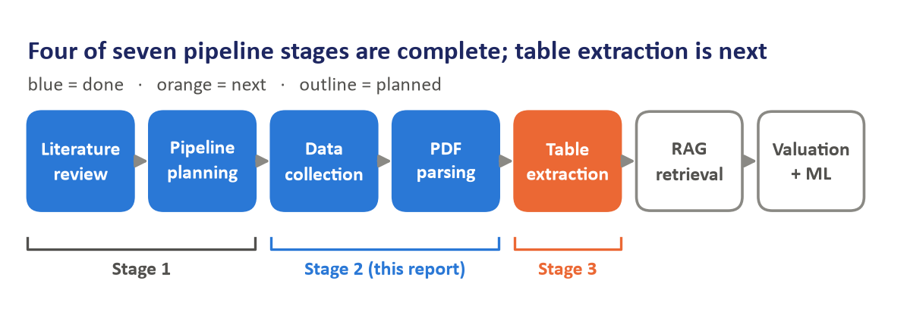
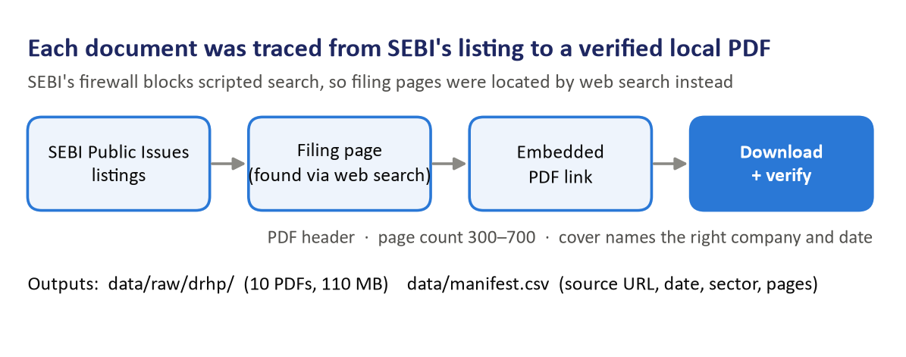
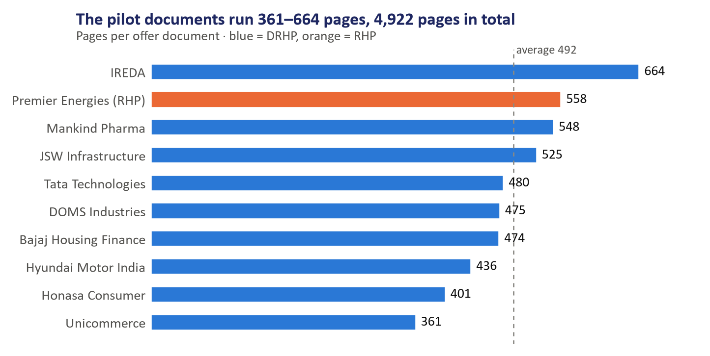
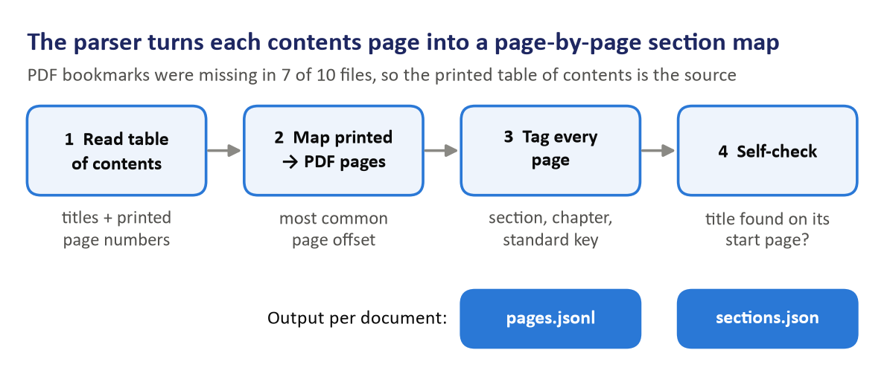
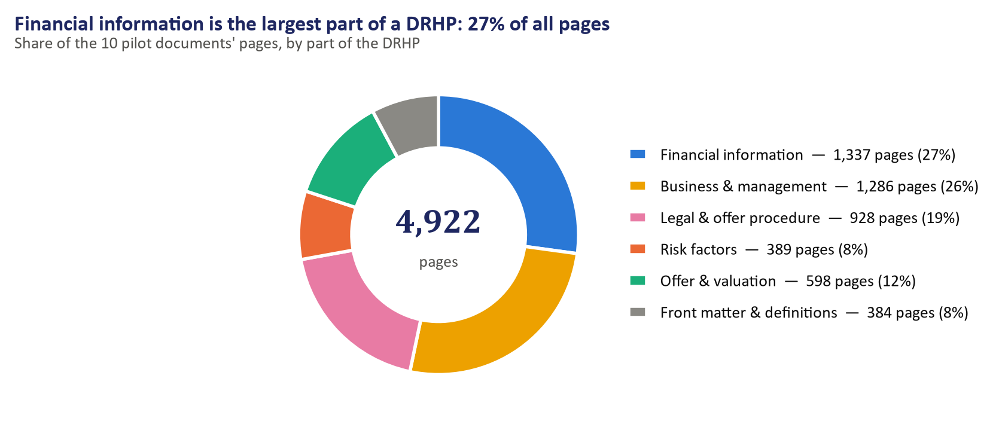
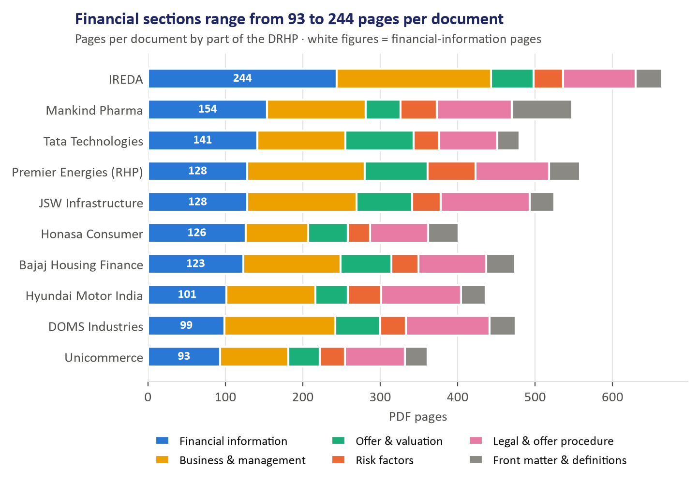
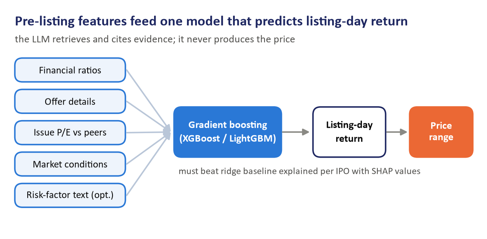
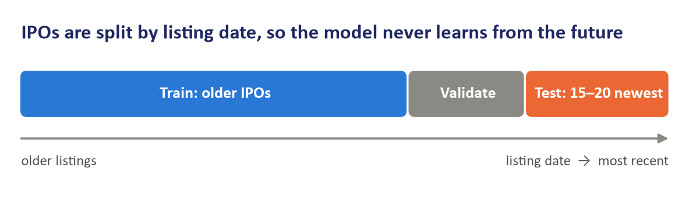
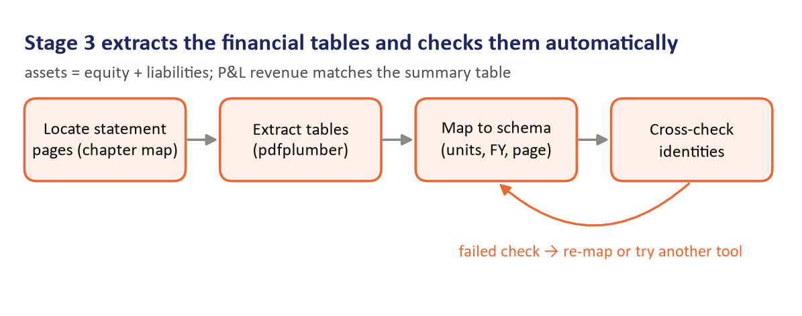

# Stage 2 Report

AI Underwriter: RAG-based DRHP Analysis and IPO Valuation · BFSI Capstone

12 October 2026

## 1. Executive summary

Stage 2 turned the project plan into a working data foundation: 10 verified offer documents (4,922 pages) are collected, every page is tagged with its DRHP section, and the ML pricing model is designed.

In Stage 1 we completed the literature review and planned a pipeline that ingests a Draft Red Herring Prospectus (DRHP), retrieves evidence with RAG, extracts and normalises the financials, computes ratios deterministically, and produces a recommended IPO price range. Stage 2 delivered the first two steps of that pipeline and fixed the design of the prediction step.

**What Stage 2 delivered**

- **Pilot dataset.** 10 offer documents downloaded from SEBI's public filings, all from mainboard IPOs that have since listed. They span 10 sectors and include two finance companies. Each file was checked for completeness and logged in a manifest with its source URL, date, sector and page count.
- **DRHP parser.** A Python parser (`src/parse_drhp.py`) reads each document's table of contents and tags every page with its section, chapter and a standard chapter label. On all 10 documents it placed 358 of 358 chapters on the correct page and found all six key chapters in every document.
- **ML model design.** The model will predict listing-day return. Gradient boosting (XGBoost or LightGBM) is the main model, ridge regression is the baseline it must beat, and testing uses a split by listing date.
- **Team deliverables.** A 19-slide progress deck and five progress slides added to the team's original plan deck.

**What comes next.** Stage 3 extracts the restated financial statements, the peer-comparison tables and the offer details into a fixed schema. In parallel the team builds a hand-checked answer set, adds issue and listing prices from NSE/BSE, and grows the historical IPO table to 100–150 listings for model training.

## 2. Background and Stage 1 recap

The AI Underwriter automates the review of DRHPs, the 300–600 page filings that Indian companies submit to SEBI before an IPO, and recommends an IPO price range with every figure traced to its source page.

Today analysts read these filings by hand. The review is slow, varies between analysts, and is hard to audit back to the page a number came from. Our system answers questions about a DRHP from retrieved evidence, extracts the restated financials into a clean schema, computes ratios in plain code rather than with an LLM, and combines comparable-company valuation with an ML model to produce a price range. Results are benchmarked against the actual issue price and listing-day returns.

**Stage 1 (completed):** literature review and pipeline planning. The review covered:

- Lewis et al. (2020) on the core Retrieval-Augmented Generation architecture.
- Cheng et al. (2026) on reranking for question answering over financial reports.
- Dadopoulos et al. (2025) on metadata-driven chunking, which shapes our section-aware design.
- Katsafados et al. (2020) on predicting IPO outcomes from prospectus text plus financials.
- Singh et al. on ML-driven pricing of Indian IPOs, our closest benchmark.

**Where Stage 2 fits.** The pipeline has seven stages: literature review, pipeline planning, data collection, PDF parsing, table extraction, RAG retrieval, and valuation with ML. Stage 1 covered the first two. Stage 2 completed data collection and PDF parsing, and designed the ML model so that the data collected now fits what the model will need later. Table extraction is next.

## 3. Dataset collection

We collected the pilot documents from SEBI's public filings and only picked companies that have already listed, because the project benchmarks against real issue and listing prices.

### Which documents the project needs

An IPO produces three offer documents, and they serve different purposes in our pipeline:

| Document | Filed with | What it contains | Role in our project |
| --- | --- | --- | --- |
| DRHP (Draft Red Herring Prospectus) | SEBI | Full business, risk and restated financial disclosure; no price band or issue price | Main document we analyse |
| RHP (Red Herring Prospectus) | Registrar of Companies, before bidding | Same structure, updated financials, adds the price band | Substitute when a DRHP is unavailable |
| Prospectus + exchange data | Registrar of Companies, after the issue; NSE / BSE | Final issue price; listing-day prices | Benchmark and ML training label |

A DRHP alone is not enough. It carries no price information, and some DRHPs lapse or are withdrawn without ever listing. So every sample company must have listed, with its issue and listing prices taken from NSE/BSE.

### How the files were collected

1. **SEBI listing pages.** SEBI's Filings › Public Issues section has three lists: draft offer documents, red herring documents and final offer documents.
2. **Filing page per document.** Each document has its own public page on sebi.gov.in. SEBI's firewall blocked scripted use of its search, which we did not try to bypass. Instead we located each company's filing page through a web search restricted to sebi.gov.in.
3. **PDF link.** Each filing page embeds the PDF in a viewer. A small script reads the direct PDF link out of the page and downloads it, with a pause between requests.
4. **Verification.** Every file was checked for a valid PDF header, a page count in the expected 300–700 range, and a cover page naming the right company and filing date.

### Problems we hit and how they were resolved

- **Blocked search.** Resolved by finding filing pages through web search (step 2).
- **One truncated download.** Unicommerce's first download was incomplete (0.7 MB of 6.8 MB). A retry produced the full 361-page file, which was re-verified.
- **Upper-case file extension.** Hyundai's link ended in `.PDF`, which the script's pattern missed. The link was fetched directly.
- **Missing filings.** Premier Energies' DRHP and Ola Electric's DRHP were not indexed (see Section 4).

All PDFs are stored in `data/raw/drhp/`, about 110 MB in total. `data/manifest.csv` records each file's company, document type, date, sector, page count and SEBI source URL. Its price columns (price band, issue price, listing date, listing open and close, subscription) are deliberately left blank, so that they are filled from NSE/BSE rather than from memory.

## 4. The pilot sample

The pilot holds 10 listed mainboard IPOs across 10 sectors, chosen for variety rather than volume, because their job is to build and test the pipeline.

| Company | Sector | Document | Document date |
| --- | --- | --- | --- |
| Tata Technologies | IT / engineering services | DRHP | 9 Mar 2023 |
| Mankind Pharma | Pharma | DRHP | 15 Sep 2022 |
| JSW Infrastructure | Ports / infrastructure | DRHP | 9 May 2023 |
| Bajaj Housing Finance | Housing finance (NBFC) | DRHP | 7 Jun 2024 |
| IREDA | Government-owned renewables financier | DRHP | 7 Sep 2023 |
| Hyundai Motor India | Automobiles | DRHP | 14 Jun 2024 |
| Honasa Consumer | Consumer / D2C | DRHP | 28 Dec 2022 |
| DOMS Industries | Manufacturing / stationery | DRHP | 22 Aug 2023 |
| Premier Energies | Solar manufacturing | RHP | 20 Aug 2024 |
| Unicommerce eSolutions | SaaS / e-commerce technology | DRHP | 5 Jan 2024 |

Together the documents total 4,922 pages, an average of 492 per document (Figure 3).

### Selection rules

- **Mainboard only.** SME filings are thinner and laid out differently, so they are left out.
- **Already listed.** Needed for the issue-price and listing-return benchmark.
- **Mixed listing outcomes.** The set aims to include both strong and weak listing-day performers, so the model sees both. This rests on general market knowledge and will be confirmed once NSE/BSE prices are in the manifest.
- **Two finance companies.** Bajaj Housing Finance and IREDA report interest income, loan books and no “revenue from operations” line, so they test whether extraction handles BFSI statements.
- **Different sizes.** The sample ranges from very large issues (Hyundai) to a small mainboard issue (Unicommerce).

### Substitutions

- **Premier Energies:** its DRHP is not indexed on SEBI, so its RHP is used. The RHP follows the same structure.
- **Ola Electric:** originally planned, but its DRHP could not be found, so Unicommerce took its place.

## 5. PDF parsing method

The parser uses each DRHP's printed table of contents to tag every page with its section and chapter, which works across issuers because SEBI's disclosure rules fix the order of sections.

### Why the table of contents

We first tried the PDFs' built-in bookmarks. Seven of the ten files had none, and the other three only bookmarked the financial statements, often with odd internal file names. Every document, however, prints a full table of contents within its first five pages, in the same format: section headings such as `SECTION II: RISK FACTORS ........ 27`, with chapters listed beneath each.

### How it works

1. **Read the table of contents.** The parser finds the contents page or pages and extracts each entry's title and printed page number. It joins titles that wrap onto a second line and accepts dot leaders of two or more dots.
2. **Map printed pages to PDF pages.** Printed page 1 is not PDF page 1, because the cover and contents come first. The parser reads the number printed at the top or bottom of every page and takes the most common gap between printed and PDF page numbers as the offset.
3. **Tag every page.** Each chapter covers the pages from its start to the next chapter's start. Every page is labelled with its section (for example SECTION V: FINANCIAL INFORMATION), its chapter title, and a standard key such as `basis_for_offer_price`, `restated_financials` or `mdna`. The keys come from pattern rules, so different wordings map to the same key; for example “Basis for Offer Price” and “Basis for Issue Price” both become `basis_for_offer_price`.
4. **Self-check.** For every chapter the parser confirms that the chapter's title actually appears near the top of the page it was mapped to. It also flags near-empty pages, which may be scanned images.

### Tools

The parser uses PyMuPDF, which is fast on 500-page files and keeps page coordinates, matching its planned role for text and page mapping. pdfplumber is installed for the next stage, table extraction.

### Output per document

Output goes to `data/processed/<document>/`:

- `pages.jsonl`: one record per page with the PDF page number, printed page number, section, chapter, standard key, character count and full text.
- `sections.json`: the chapter map, with each chapter's title, key, start and end pages, whether the title was confirmed on its start page, and the page offset and how consistent it was.

The page numbers in this output are what later lets every answer and extracted figure cite its source page. The standard keys let later stages ask for, say, the Basis for Offer Price pages of any document without knowing its exact wording.

## 6. Parsing results and issues

On all 10 documents the parser placed 358 of 358 chapters on the correct start page, and found all six key chapters in every document.

The six key chapters are the ones later stages depend on: Risk Factors, Objects of the Offer, Basis for Offer Price, Our Business, Restated Financial Information, and Management's Discussion and Analysis (MD&A).

| Document | Pages | Chapters found | Titles confirmed | Page offset | Pages agreeing with offset | Near-empty pages |
| --- | --- | --- | --- | --- | --- | --- |
| Bajaj Housing Finance | 474 | 36 | 36 / 36 | 4 | 100% | 3 |
| DOMS Industries | 475 | 37 | 37 / 37 | 3 | 100% | 1 |
| Honasa Consumer | 401 | 34 | 34 / 34 | 4 | 100% | 4 |
| Hyundai Motor India | 436 | 35 | 35 / 35 | 4 | 100% | 4 |
| IREDA | 664 | 37 | 37 / 37 | 0 | 100% | 2 |
| JSW Infrastructure | 525 | 38 | 38 / 38 | 3 | 100% | 1 |
| Mankind Pharma | 548 | 35 | 35 / 35 | 3 | 97% | 3 |
| Premier Energies | 558 | 36 | 36 / 36 | 3 | 100% | 8 |
| Tata Technologies | 480 | 35 | 35 / 35 | 2 | 96% | 9 |
| Unicommerce eSolutions | 361 | 35 | 35 / 35 | 3 | 100% | 4 |

IREDA's offset of 0 is correct: unusually, its cover and contents pages carry printed numbers too. The 39 near-empty pages are mostly blank pages and section dividers, plus the scanned pages noted below.

### Where the pages go

Because every page is now tagged, we can measure how a DRHP is made up. We grouped the 35-odd chapters into six parts. Financial information (restated statements, MD&A, capitalisation and borrowings) is the largest, at 27% of all pages, closely followed by business and management at 26% (Figure 5). Risk factors take only 8% of pages but are the main input for the risk summary.

The financial part varies more than three-fold between documents, from 93 pages (Unicommerce) to 244 (IREDA) (Figure 6). IREDA's is longest: its restated financial statements alone run 179 pages, and as a lender it adds an 11-page chapter of selected statistical information. For table extraction this means the statement pages must be located inside the chapter rather than assumed to sit at a fixed position.

### Issues found and fixed

The first run found every key chapter except one, and the review of the chapter maps exposed two bugs:

1. **Mankind Pharma's MD&A chapter was missed.** Its contents line had only two dots before the page number (`.. 420`), and its apostrophe extracted as a garbled character. The entry was skipped, so the 28 MD&A pages were wrongly folded into the preceding Capitalisation Statement chapter. **Fix:** the parser now accepts two-dot leaders and normalises apostrophes. MD&A is now found on PDF pages 424–451.
2. **“Other Financial Information” was labelled as restated financials.** A general pattern was checked before the more specific one. **Fix:** specific chapter patterns are checked first, and keys were added for offer terms, offer structure, offer procedure and selected statistical information.

After the fixes all 10 documents were re-run. Only one chapter in the whole set still has no standard key: JSW Infrastructure's “Notice to Prospective Investors Outside India”, which no later stage needs.

### Open limitation

Premier Energies' PDF pages 334–338 are images with no text layer, most likely the scanned auditor's examination report. They will need OCR (text recognition) if the auditor's opinion is ever required. The restated financial statements themselves start on page 339 as normal text, so table extraction is not blocked.

## 7. ML model design

The model will predict an IPO's listing-day return from information available before listing, and will be trained on 100–150 historical mainboard IPOs rather than the 10-document pilot.

### Target variable

The target is the listing-day return:

Listing-day return = (Listing price − Issue price) ÷ Issue price

This is the standard target in IPO research, it matches our benchmark, and a percentage can be compared across issues of very different sizes. A predicted price range follows directly from the predicted return and the issue price band. The LLM never produces the price: it retrieves and cites evidence, while plain code and the ML model produce every number.

### Features

| Feature group | Examples | Where it comes from |
| --- | --- | --- |
| Financials | Revenue growth, PAT margin, EBITDA margin, return on equity, debt/equity, EPS | Table extraction + ratio engine (Stage 3) |
| Offer details | Issue size, share of fresh issue vs offer for sale (OFS), promoter holding after the issue | Capital structure and Objects of the Offer chapters |
| Valuation | Issue P/E compared with the average P/E of the listed peers named in the DRHP | Basis for Offer Price chapter |
| Market conditions | Nifty return in the month before the IPO; sector | Market data |
| Document text (optional) | Number of risk factors; text embeddings of Risk Factors | Parsed pages, following Katsafados et al. (2020) |

**An open choice: subscription data.** Subscription levels are strong predictors of listing returns, but they are only known when bidding closes. If the model is meant to run before bidding, they must be left out; if it runs after bidding closes, they can be included. The team needs to decide which.

### Data requirements

With only 10 or even 30 IPOs a model cannot learn a reliable pattern. India has had roughly 50–90 mainboard IPOs a year recently, so two to three years of listings give 100–150 rows. The full RAG pipeline does not have to run on all of them: the model only needs the feature table and the outcome. Once extraction works on the pilot, it is run over the larger set to fill that table.

## 8. Model selection rationale

Gradient boosting (XGBoost or LightGBM) is the main model because it suits a small table of numbers, learns interactions on its own, and can explain each prediction; ridge regression is the baseline it must beat.

### Candidates compared

| Model | With ~150 IPOs | Captures non-linear effects | Explainability | Role |
| --- | --- | --- | --- | --- |
| Linear / ridge regression | Works well | No | High: coefficients | Baseline |
| Random forest | Works well | Yes | Medium | Alternative |
| Gradient boosting (XGBoost / LightGBM) | Works, with tuning | Yes, including interactions | High: SHAP values | **Main model** |
| Deep neural network | Overfits | Yes | Low | Not used |

The choice is driven by the shape of our data: about 150 rows of mostly numeric features. We will train ridge regression, random forest and gradient boosting and compare them on the same test period.

### Why gradient boosting

1. **Built for small tabular data.** On tables of a few hundred rows of numeric features, boosted trees consistently outperform neural networks, which need far more examples.
2. **Learns interactions on its own.** A high issue P/E may only hurt listing returns when listed peers trade at lower multiples, or when the market is weak. Trees find such combined effects without us having to specify them in advance, which a linear model cannot do.
3. **Explainable predictions.** SHAP values split each prediction into the contribution of each feature (an illustrative example: “peer valuation gap −3.1 points, strong revenue growth +2.4 points”). An underwriting report must show why it recommends a price, and this gives that reasoning directly.
4. **Practical to train.** It handles missing values and categorical inputs such as sector, and it has built-in controls against overfitting.

### Safeguards against overfitting

With only 100–150 rows, a complex model can look good by chance. We therefore:

- keep trees shallow and use early stopping on the validation period;
- limit the model to about 25 features;
- require gradient boosting to beat ridge regression on the held-out test period, and report the simpler model if it does not;
- rule out neural networks entirely, because there is too little data to train one reliably.

## 9. Evaluation plan

The model will be tested on the 15–20 most recent IPOs, never seen in training, with the data split by listing date so that it never learns from the future.

### Time-aware split

IPOs are sorted by listing date. The oldest form the training set, the next period is used for validation (tuning and early stopping), and the 15–20 most recent IPOs are held back as the test set. A random split would let the model train on IPOs that listed after the ones it is tested on, and so learn from market conditions it could not have known. Splitting by date mimics real use: pricing the next IPO using only what was known before it.

### Metrics

| Metric | What it measures |
| --- | --- |
| Mean absolute error | Average miss on listing-day return, in percentage points |
| Direction accuracy | Share of IPOs where we correctly predict a gain or a loss on listing |
| Range hit rate | Share of IPOs whose actual listing price falls inside our recommended price range |

### Baselines to beat

- The average historical listing-day return (predicting the same return for every IPO).
- The price implied by the peer-average P/E from the Basis for Offer Price chapter.
- Ridge regression on the same features.

Results will also be compared against Singh et al., our closest published benchmark for Indian IPO pricing.

### Avoiding data leakage

Only information available before listing may be used as a feature. Listing-day prices, post-listing volumes, news and analyst notes are outcomes, never inputs. Issue and listing prices are stored in the manifest for evaluation only. Every feature will carry an “as of” date, and a check will confirm that it is no later than the listing date.

## 10. Next steps and risks

Stage 3 is table extraction: turning the financial statements, peer tables and offer details of the 10 pilot documents into clean, checked data.

### Stage 3 work plan

1. **Locate the statement pages.** Within the `restated_financials` chapter, find the restated balance sheet, profit and loss statement and cash flow statement by their headings, rather than scanning hundreds of pages.
2. **Extract the tables.** Run pdfplumber (with Camelot or Docling as alternatives) on only those pages and save each table as a CSV file.
3. **Map to a fixed schema.** Map line items such as “Revenue from operations”, “Profit for the year” and “Total equity” into one schema per company, recording units (₹ lakh or ₹ million), the financial year and the source page of every figure. Bajaj Housing Finance and IREDA get a separate mapping for finance-company statements.
4. **Cross-check automatically.** Total assets must equal total equity plus liabilities, and revenue in the P&L must match the summary financial table. These checks catch extraction errors without manual review.
5. **Peer comparison and offer details.** Extract the peer table (EPS, P/E, return on net worth, NAV) from the Basis for Offer Price chapter, and issue size and the fresh issue / OFS split from the offer chapters.

### In parallel

- [ ] **Hand-checked answer set:** for 2–3 companies, copy about 10 key figures from the PDF by hand (revenue, PAT and total equity for each year, plus peer P/Es) with page numbers. This is how extraction accuracy is measured.
- [ ] **Fill the price columns** of the manifest from NSE/BSE: price band, issue price, listing date, listing-day open and close, subscription.
- [ ] **Align the manifest with the planned metadata schema** by adding issue size and fresh issue / OFS columns.
- [ ] **Grow the historical IPO list** to 100–150 mainboard listings from 2022–2025 for model training.
- [ ] **Decide** whether the model runs before or after bidding closes (this decides whether subscription data is allowed).

### Risks

| Risk | Effect | Mitigation |
| --- | --- | --- |
| Tables split badly across columns or pages | Wrong or missing figures | Cross-checks flag failures; compare several extraction tools on the same pages |
| Finance-company statements differ in structure | Standard schema does not fit Bajaj Housing and IREDA | Separate line-item mapping for NBFCs |
| Scanned pages in some filings | No text to extract | OCR fallback, with its figures validated by the cross-checks |
| Small training set (100–150 IPOs) | Model overfits or results are unstable | Shallow trees, about 25 features, ridge baseline, date-based test set |
| SEBI blocks scripted search | Collecting 100–150 documents is slower | Locate filing pages by web search; the ML table needs features, not full RAG on every document |

## Appendix: Stage 2 files

All Stage 2 outputs are in the project folder:

| File or folder | Contents |
| --- | --- |
| `data/raw/drhp/` | The 10 pilot PDFs (9 DRHPs, 1 RHP), about 110 MB |
| `data/manifest.csv` | One row per document: company, file, document type, date, sector, pages, SEBI source URL; price columns to be filled |
| `src/parse_drhp.py` | The DRHP parser; run `python src/parse_drhp.py` (all files) or `--only <name>` |
| `data/processed/<document>/pages.jsonl` | One record per page: page numbers, section, chapter, standard key, text |
| `data/processed/<document>/sections.json` | Chapter map with page ranges, title checks and page offset |
| `src/make_report_figures.py` | Regenerates every chart and diagram in this report from the parser output |
| `report_figures/` | The nine figures (PNG) |
| `AI_Underwriter_Team_Plan.pptx` | 19-slide Stage 2 progress deck |
| `AI_Underwriter_Team_Plan_1.pptx` | Team plan deck with five Stage 2 progress slides added (slides 29–33) |

**Sources.** All offer documents were downloaded from SEBI's Public Issues filings at [sebi.gov.in](https://www.sebi.gov.in/sebiweb/home/HomeAction.do?doListing=yes&sid=3&ssid=15&smid=10); the exact URL of each file is recorded in `data/manifest.csv`.
